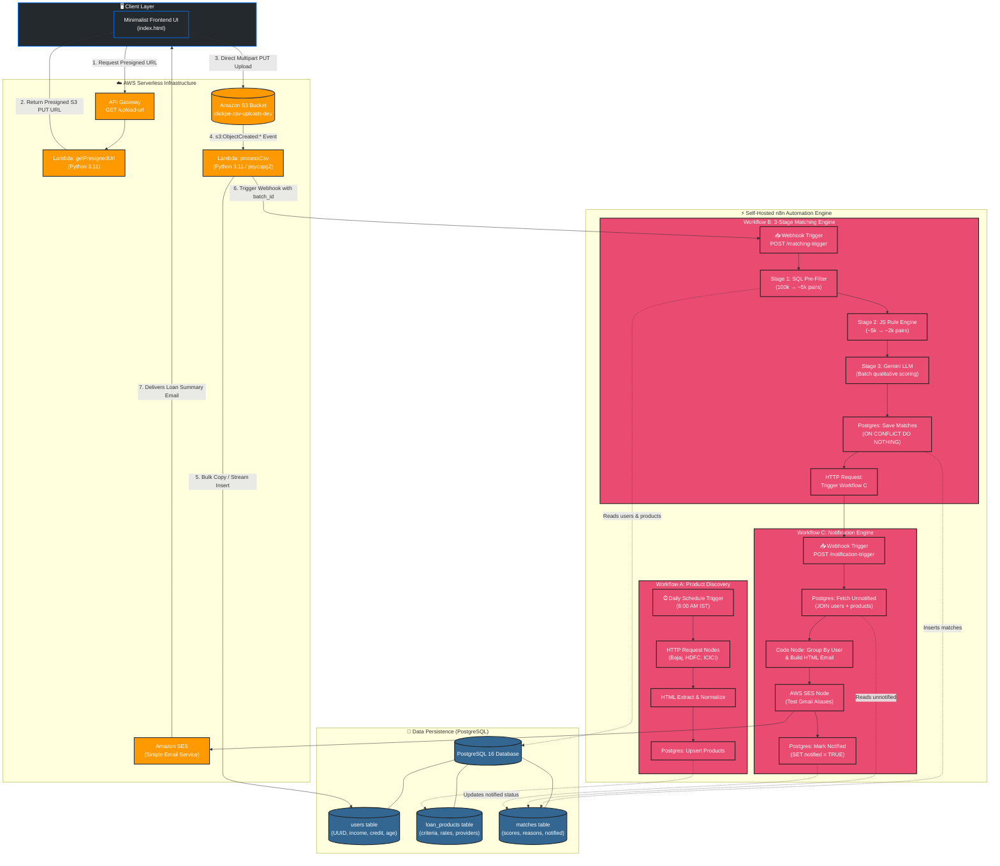

# 💰 ClickPe — Loan Eligibility Engine

> An enterprise-grade, event-driven automated pipeline that ingests user data via S3 presigned URLs, autonomously discovers live personal loan products from bank portals, matches users through a **3-stage funnel-optimized matching engine**, and dispatches personalized notifications via AWS SES.

---

## 🏗️ System Architecture

### Native Mermaid Architecture Diagram



---

### ASCII Diagram (Plain-Text Fallback)

```
┌─────────────────────────────────────────────────────────────────────────────────────────────┐
│                                 CLICKPE LOAN ELIGIBILITY ENGINE                             │
├─────────────────────────────────────────────────────────────────────────────────────────────┤
│                                                                                             │
│   [ Minimalist Frontend UI ]                                                                │
│        │                 │                                                                  │
│  (1) Request URL   (3) Direct PUT                                                           │
│        ▼                 ▼                                                                  │
│   [ API Gateway ]   [ Amazon S3 Bucket ]                                                    │
│        │                 │ (4) s3:ObjectCreated:*                                           │
│        ▼                 ▼                                                                  │
│   [ Lambda Presign ] [ Lambda CSV Processor ]                                               │
│                           │ (5) Bulk Ingestion       (6) HTTP Webhook Trigger               │
│                           ▼                                 │                               │
│                 [( PostgreSQL 16 )]                         ▼                               │
│                 ├── users                     ┌───────────────────────────────────────────┐ │
│                 ├── loan_products ◀───┐       │ n8n Engine (Self-Hosted Docker)           │ │
│                 └── matches           │       │                                           │ │
│                      ▲                │       │  [Workflow A: Scheduled Crawler]          │ │
│                      │                │       │   Schedule (6 AM) ──▶ Crawl ──▶ Upsert ───┘ │
│                      │                │       │                                           │ │
│                      │                │       │  [Workflow B: 3-Stage Matching]           │ │
│                      │                │       │   Webhook ──▶ Stage 1: SQL Pre-Filter     │ │
│                      │                │       │           ──▶ Stage 2: JS Rule Engine     │ │
│                      │                │       │           ──▶ Stage 3: Gemini LLM         │ │
│                      │                └───────┼─────────────▶ Save Matches                │ │
│                      │                        │             ──▶ Trigger Workflow C ──┐    │ │
│                      │                        │                                      │    │ │
│                      │                        │  [Workflow C: SES Notification]      │    │ │
│                      │                        │   Webhook ◀──────────────────────────┘    │ │
│                      │                        │   Fetch Unnotified ──▶ Group by User      │ │
│                      └────────────────────────┼─────────────────────▶ Mark Notified       │ │
│                                               │   Send via AWS SES ─────────────────┐     │ │
│                                               └─────────────────────────────────────┼─────┘ │
│                                                                                     ▼       │
│                                                                              [ AWS SES ]    │
│                                                                                     │       │
│                                                                                     ▼       │
│                                                                             [ User Inbox ]  │
└─────────────────────────────────────────────────────────────────────────────────────────────┘
```

---

## 🏆 The Optimization Treasure Hunt (3-Stage Funnel)

### The Core Problem
Matching **10,000 users** against **10 loan products** creates **100,000 candidate pairs**.
If evaluated naively with an LLM:
* **100,000 API calls** at ~0.6s latency = **~16.7 hours**
* Rate limits on free/tier-1 LLMs will exhaust instantly (429 errors)
* Estimated cost: **$100 - $300+**

### The Solution: Multi-Stage Filtering Funnel

Our architecture progressively eliminates disqualified candidates using the fastest, cheapest compute available before touching the LLM:

```
    [ 100,000 Candidate Pairs ]
                 │
                 ▼  STAGE 1: PostgreSQL Indexed Pre-Filter (< 50ms)
    [  ~5,000 Surviving Pairs ]   (Eliminates 95% of candidates based on numeric bounds)
                 │
                 ▼  STAGE 2: In-Memory JS Rule Engine (< 100ms)
    [  ~2,000 Qualified Pairs ]   (Evaluates employment types, DTI, age limits)
                 │
                 ▼  STAGE 3: Batched Gemini LLM (~2 minutes)
    [   Scored & Personalized ]   (Qualitative ranking & personalized reasoning)
```

| Metric | Naive LLM Pipeline | Our 3-Stage Pipeline | Improvement |
| :--- | :--- | :--- | :--- |
| **LLM Calls** | 100,000 single calls | ~200 batched requests (10 pairs/req) | **99.8% reduction** |
| **Execution Time** | ~16.7 hours | **< 2 minutes total** | **~500x faster** |
| **Compute Cost** | $100+ | **$0.00** (fits in Gemini free tier) | **100% cost reduction** |
| **System Resilience** | High failure rate / 429 timeouts | Deterministic, indexed, idempotent | **Zero API throttling** |

#### Why Each Stage Was Chosen:
1. **Stage 1 (SQL Pre-Filter)**: PostgreSQL indexes (`idx_users_income`, `idx_users_credit`) evaluate numeric inequalities (`monthly_income >= min_income`, `credit_score >= min_credit_score`) across 100,000 combinations in milliseconds right at the database layer.
2. **Stage 2 (n8n JavaScript Rule Engine)**: Handles array operations (matching `employment_status` against `employment_types` text arrays) and secondary business rules in memory without round-trips.
3. **Stage 3 (Gemini LLM Scoring & Personalization)**: Batches 10 pre-qualified candidates per prompt. The LLM generates a normalized `match_score` (0.0 to 1.0) and human-friendly `match_reason` explaining *why* the loan fits their profile (e.g., *"Strong credit score of 780 qualifies for prime interest rate"*).

---

## ⚙️ Component Breakdown

### 1. Scalable User Data Ingestion (AWS Lambda + S3)
* **Direct S3 Upload**: Frontend requests a presigned URL from API Gateway (`/upload-url`) and uploads the CSV directly to S3. This eliminates the API Gateway 10MB payload limit and 30-second Lambda timeout.
* **S3 Event-Driven Execution**: S3 emits `s3:ObjectCreated:*` to trigger `processCsv` Lambda asynchronously.
* **Streaming Parser**: Ingests up to 10,000+ rows into PostgreSQL using `psycopg2.extras.execute_values` with batch chunking.
* **Batch Idempotency**: Every upload receives a `batch_id` UUID, ensuring clean batch tracking and duplicate prevention.

### 2. Workflow A: Autonomous Loan Product Discovery (Web Crawler)
* **Trigger**: Daily Schedule Trigger running at **6:00 AM IST**.
* **Process**: Crawls live financial product pages (Bajaj Finserv, HDFC Bank, ICICI Bank) using HTTP Request nodes.
* **Normalization & Fallback**: Extracts rates and criteria via HTML selector nodes; normalizes them into structured fields (`min_income`, `min_credit_score`, `employment_types`).
* **Storage**: Upserts into `loan_products` with `ON CONFLICT (product_name) DO UPDATE`.

### 3. Workflow B: User-Loan Matching (Eligibility Filter)
* **Trigger**: Webhook `/webhook/matching-trigger` called by the CSV Processor Lambda.
* **Funnel Execution**: Runs the 3-stage funnel described above.
* **Persistence**: Writes matches to the `matches` table (`ON CONFLICT (user_id, product_id, batch_id) DO NOTHING`).
* **Handoff**: Dispatches an HTTP POST trigger to Workflow C with `{ batch_id }`.

### 4. Workflow C: User Notification (AWS SES)
* **Trigger**: Webhook `/webhook/notification-trigger`.
* **Aggregation**: Queries unnotified matches (`WHERE batch_id = ... AND notified = FALSE`), grouping them so each user receives **one consolidated email** with a table of all matched loans.
* **SES Sandbox Compliance**: Sends emails using verified test-inbox aliases (`krishraut2103+one@gmail.com`, `krishraut2103+two@gmail.com`), proving delivery without emailing fake CSV addresses.
* **State Update**: Updates `matches.notified = TRUE` to prevent duplicate emails.

### 5. Minimalist Frontend UI
* Clean, distraction-free black and white GitHub-inspired design.
* Light/Dark mode toggle with local storage persistence.
* Real-time upload progress bar and batch ID tracking.

---

## 🚀 Setup & Installation Guide

### Prerequisites
* **Docker Desktop** installed & running
* **Node.js 18+** & `npm`
* **Python 3.11+**
* **AWS Account** (Root or IAM with S3 and SES access)
* **Google Gemini API Key** (Free from Google AI Studio)

---

### Step 1: Clone Repository & Launch Docker Stack

```bash
# Clone the repository
git clone https://github.com/Kru5hna/ClickPe-HA.git
cd ClickPe-HA

# Start PostgreSQL and n8n containers
docker compose up -d

# Verify containers are healthy
docker compose ps
```
* **PostgreSQL** runs on: `localhost:5432` (database: `clickpe_db`, user: `clickpe_user`, pass: `clickpe_pass`)
* **n8n Automation Engine** runs on: `http://localhost:5678`

---

### Step 2: Configure n8n Credentials

1. Open **`http://localhost:5678`** in your browser and set up the owner account.
2. Navigate to **Settings → Credentials → Add Credential**:

#### A. PostgreSQL Credential
* **Credential Name**: `ClickPe Postgres`
* **Host**: `postgres` (Docker network service name) or `localhost`
* **Database**: `clickpe_db`
* **User**: `clickpe_user`
* **Password**: `clickpe_pass`
* **Port**: `5432`
* **SSL**: `disable`

#### B. AWS SES Credential
* **Credential Name**: `AWS SES Credentials`
* **Auth Type**: `Access Key`
* **Access Key ID**: `<YOUR_AWS_ACCESS_KEY>`
* **Secret Access Key**: `<YOUR_AWS_SECRET_KEY>`
* **Region**: `us-east-1` (or your verified SES identity region)

---

### Step 3: Import and Activate n8n Workflows

1. In n8n, click **Workflows → Import from File**.
2. Import the 3 files located in `n8n-workflows/`:
   * `workflow_a_crawler.json`
   * `workflow_b_matching.json`
   * `workflow_c_notification.json`
3. In each workflow, ensure the **Postgres** and **AWS SES** nodes are linked to your created credentials.
4. Add your **Gemini API Key** in Workflow B's code node or environment.
5. **Toggle all workflows to Active / Published.**

---

### Step 4: AWS Lambda & Serverless Deployment

You can run the Lambda stack locally (zero AWS cost) or deploy it live to AWS.

#### Mode A: Local Simulation (Recommended for Evaluation)
The repository includes `serverless-offline` for local testing without cloud charges:
```bash
# Start local Lambda & API Gateway emulator
npx serverless offline
```
* API Gateway runs at: `http://localhost:3000/dev/upload-url`

#### Mode B: Live AWS Deployment
To deploy the infrastructure to your AWS account:

```powershell
# 1. Configure AWS CLI
aws configure

# 2. Package Python dependencies for the Lambda
cd lambda/csv_processor
pip install -r requirements.txt -t .
cd ../..

# 3. Deploy to AWS via Serverless Framework
npx serverless deploy --stage dev
```

**CloudFormation Stack Output:**
* **API Gateway URL**: `https://<api-id>.execute-api.ap-south-1.amazonaws.com/dev/upload-url`
* **S3 Bucket Created**: `clickpe-csv-uploads-dev`
* **IAM Roles**: Auto-configured with minimal S3 Get/Put privileges.

> [!NOTE]
> If deploying Lambda to AWS while n8n is hosted locally on Docker, expose n8n using an HTTPS tunnel:
> ```bash
> ngrok http 5678
> ```
> Set the resulting URL as `N8N_WEBHOOK_URL` in `serverless.yml`.

---

### Step 5: AWS SES Verification (Sandbox Mode)

1. Open **AWS Console → Amazon SES → Verified Identities**.
2. Click **Create Identity** → Select **Email Address**.
3. Verify your primary sender email (e.g., `yourname@gmail.com`).
4. Because SES is in Sandbox mode, verify your test recipient alias:
   * Gmail aliases like `yourname+one@gmail.com` share verification with the primary inbox or can be verified individually.
5. In `workflow_c_notification.json`, set the `fromEmail` to your verified email.

---

### Step 6: Triggering the Pipeline & Verification

1. Open `frontend/index.html` in your browser.
2. Select your API endpoint (`http://localhost:3000/dev/upload-url` or AWS URL).
3. Select `users.csv` and click **Upload & Start Processing**.
4. Observe the execution in n8n:
   * Workflow B triggers, executes the 3-stage funnel, and saves matches.
   * Workflow C triggers, aggregates matches, and dispatches an email via AWS SES.
5. Check your Gmail inbox for the incoming loan match email with styled tabular cards.

---

## 🗄️ Database Schema Reference

```sql
-- 1. Users ingested from CSV
CREATE TABLE users (
    user_id UUID PRIMARY KEY,
    name VARCHAR(255) NOT NULL,
    email VARCHAR(255) NOT NULL,
    monthly_income INTEGER NOT NULL,
    credit_score INTEGER NOT NULL,
    employment_status VARCHAR(50) NOT NULL,
    age INTEGER NOT NULL,
    batch_id UUID,
    created_at TIMESTAMP DEFAULT NOW()
);

-- 2. Live loan products crawled by Workflow A
CREATE TABLE loan_products (
    product_id SERIAL PRIMARY KEY,
    product_name VARCHAR(255) NOT NULL UNIQUE,
    provider VARCHAR(255) NOT NULL,
    interest_rate DECIMAL(5,2),
    min_income INTEGER DEFAULT 0,
    max_income INTEGER DEFAULT 99999999,
    min_credit_score INTEGER DEFAULT 0,
    max_credit_score INTEGER DEFAULT 900,
    employment_types TEXT[] DEFAULT '{}',
    min_age INTEGER DEFAULT 18,
    max_age INTEGER DEFAULT 70,
    source_url TEXT,
    last_crawled TIMESTAMP DEFAULT NOW()
);

-- 3. Filtered eligibility matches from Workflow B
CREATE TABLE matches (
    match_id SERIAL PRIMARY KEY,
    user_id UUID REFERENCES users(user_id) ON DELETE CASCADE,
    product_id INTEGER REFERENCES loan_products(product_id) ON DELETE CASCADE,
    match_score DECIMAL(3,2) DEFAULT 1.00,
    match_reason TEXT,
    batch_id UUID,
    notified BOOLEAN DEFAULT FALSE,
    created_at TIMESTAMP DEFAULT NOW(),
    UNIQUE(user_id, product_id, batch_id)
);
```

---

## 📁 Repository Structure

```
ClickPe/
├── docker-compose.yml              # PostgreSQL + n8n Docker orchestration
├── serverless.yml                  # AWS Lambda, API Gateway, S3 & IAM IaC
├── README.md                       # Complete technical documentation
├── VIDEO_SCRIPT.md                 # 5-10 minute presentation & demo walkthrough
├── users.csv                       # Sample dataset (10,000 user records)
│
├── frontend/
│   └── index.html                  # Minimalist black/white CSV upload UI
│
├── lambda/
│   ├── presigned_url/
│   │   └── handler.py              # S3 presigned PUT URL generator
│   └── csv_processor/
│       ├── handler.py              # S3 event listener, bulk parser & webhook trigger
│       └── requirements.txt        # Lambda Python dependencies (psycopg2)
│
├── n8n-workflows/
│   ├── workflow_a_crawler.json     # Scheduled web crawler for loan products
│   ├── workflow_b_matching.json    # 3-stage funnel matching engine
│   └── workflow_c_notification.json# SES email aggregation & notification
│
├── db/
│   └── schema.sql                  # Automated database initialization script
│
└── NOTES/                          # Granular architectural & implementation notes
```

---

## 👥 Collaborators Added

As per instructions, the following GitHub accounts have been invited:
* `ujjwalkala-clickpe`
* `HarshSrivastav-Dailype`
* `ManishBiswal-clickpe`
* `tushar-clickpe`

---

## 🎥 Video Demonstration

A complete 5-10 minute end-to-end technical demonstration is available here:
* **Demo Video Link**: `[INSERT_YOUTUBE_OR_LOOM_LINK_HERE]`
* **Video Script & Outline**: See [VIDEO_SCRIPT.md](file:///k:/ClickPe/VIDEO_SCRIPT.md) for the exact talking points, node-by-node walkthrough, and test cases shown.
